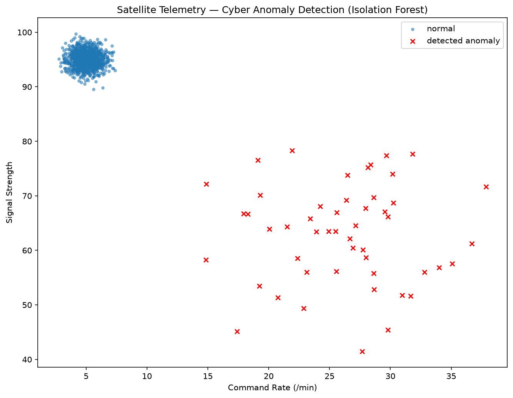
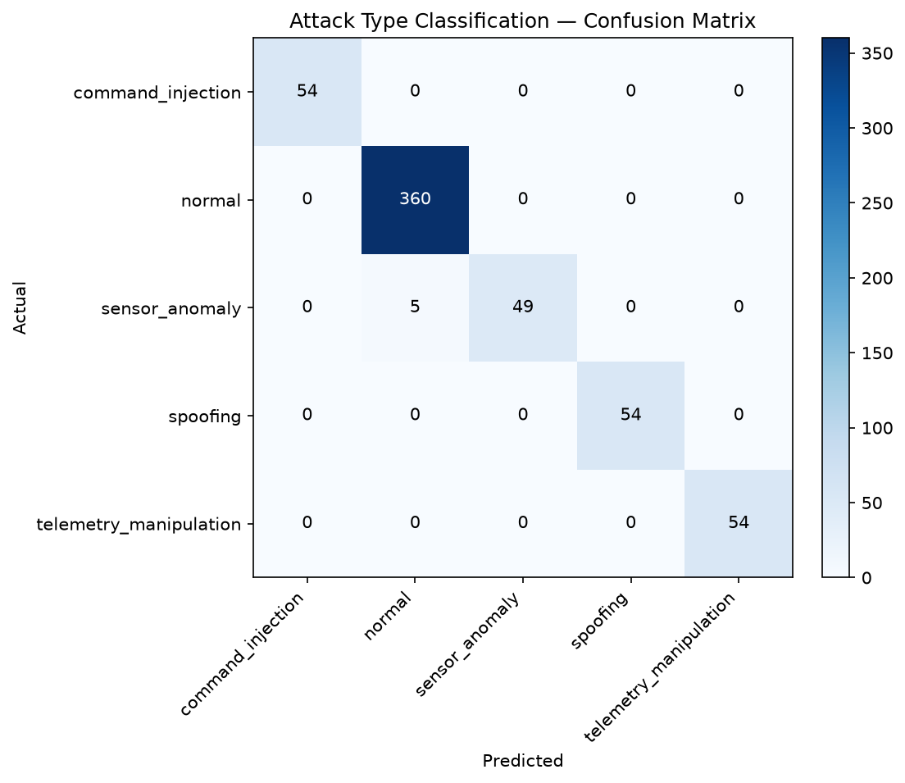
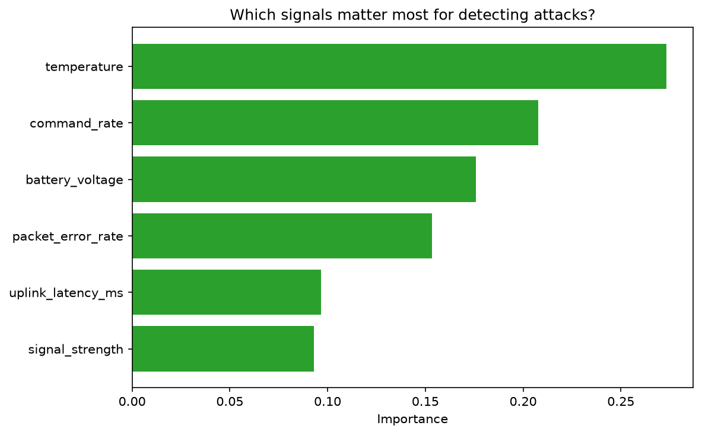
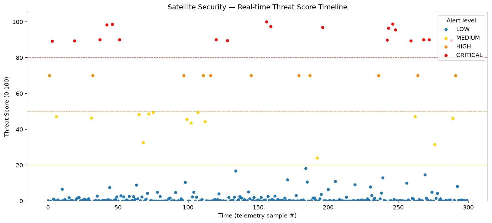
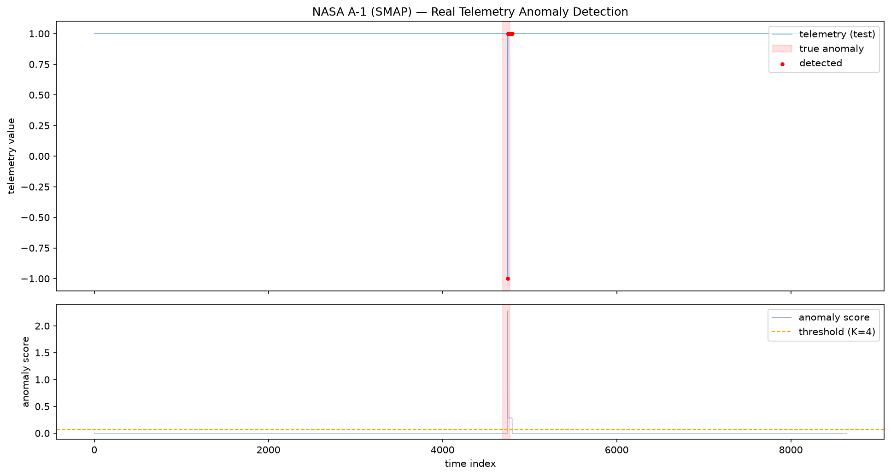

# 🛰️ Satellite Telemetry Cyber Attack Detection

정상적인 위성 Telemetry와 **사이버 공격·이상 패턴**을 구분하는
**우주 시스템 보안 이상탐지 시스템**입니다.

> **Cybersecurity + Data Science + Space Systems**를 한 번에 보여주는 포트폴리오 프로젝트.
> 비지도 이상탐지 → 공격 유형 분류 → 위협 점수 → 실시간 경보 → 관제 대시보드까지 **5단계**로 완성했습니다.
> 명령어는 복사해서 **PowerShell**에 붙여넣으면 됩니다.

---

## 📦 0. 전체 그림

```txt
Satellite
  → Telemetry
  → Ground Station
  → Security Monitoring
  → Anomaly Detection   (정상 vs 공격 패턴 구분)
  → Threat Score        (위협 점수)
  → Dashboard           (실시간 관제 화면)
```

**탐지 대상 공격:**

| 공격 유형 | 설명 | 데이터상 신호(signature) |
|---|---|---|
| Spoofing | 가짜 신호로 위성/지상국 속이기 | 신호세기 비정상 + 지연·패킷오류 급증 |
| Command Injection | 비정상 명령 주입 | 명령률(command_rate) 폭주 |
| Telemetry Manipulation | 상태값(전압·온도) 조작 | 전압 하락 + 온도 상승 고정 |
| Sensor Anomaly | 센서값 이상 | 온도 센서 큰 요동(분산↑) |

**사용 피처(6종):** `battery_voltage`, `command_rate`, `signal_strength`, `temperature`, `uplink_latency_ms`, `packet_error_rate`

---

## 🧰 1. 환경 구축

```powershell
cd "C:\projects\satellite-cyber-anomaly-detection"
```
```powershell
python -m venv .venv
```
```powershell
.\.venv\Scripts\Activate.ps1
```
> 스크립트 실행 오류가 나면 한 번만: `Set-ExecutionPolicy -Scope CurrentUser -ExecutionPolicy RemoteSigned`
```powershell
python -m pip install --upgrade pip
```
```powershell
pip install -r requirements.txt
```

**라이브러리**

| 라이브러리 | 역할 |
|---|---|
| `numpy`, `pandas` | 데이터 생성/처리 |
| `scikit-learn` | 이상탐지·분류 모델 |
| `matplotlib` | 결과 시각화 |
| `fastapi`, `uvicorn` | 보안관제 대시보드 (Step 5) |

---

## 🚀 2. 실행 방법 (Step 1~5)

`(.venv)` 가 켜진 상태에서 순서대로 실행합니다.

```powershell
python src\01_detect_anomalies.py     # Step 1: 비지도 이상탐지
python src\02_classify_attacks.py     # Step 2: 공격 유형 분류
python src\03_threat_score.py         # Step 3: 위협 점수
python src\04_realtime_monitor.py     # Step 4: 실시간 스트림 탐지
python src\05_dashboard.py            # Step 5: 대시보드 (→ http://127.0.0.1:8000)
python src\06_nasa_real_data.py A-1   # Step 6(옵션): 실제 NASA 데이터 검증
```

> 대시보드는 브라우저에서 `http://127.0.0.1:8000` 접속, 끄기는 터미널에서 `Ctrl+C`.
> Step 6은 실제 NASA 데이터 다운로드가 필요합니다(아래 §4 참고).

---

## 🧭 3. 단계별 설명 & 결과

### ✅ Step 1 — 비지도 이상탐지 (Isolation Forest)
정상 telemetry에 공격 샘플을 섞고, **라벨 없이** "정상에서 벗어난 것"을 Isolation Forest로 탐지합니다.
"정상이 어떤 모습인지"만 보고 이상을 잡는 방식.



### ✅ Step 2 — 공격 유형 분류 (RandomForest)
Step 1이 "정상 vs 이상"만 봤다면, Step 2는 공격을 **유형별로** 구분합니다(지도학습).
혼동행렬과 피처 중요도로 "어떤 신호가 어떤 공격을 가리키는지"까지 봅니다.




### ✅ Step 3 — 위협 점수 (Threat Score)
분류기의 **확률 출력** × **유형별 위험 가중치**로 0~100 위협 점수를 만들고,
점수대에 따라 경보 등급(LOW/MEDIUM/HIGH/CRITICAL)을 매깁니다. (SOC의 리스크 스코어링)

```txt
threat_score = 100 × Σ ( P(공격유형) × 위험가중치 )
위험가중치: command_injection 1.0 > telemetry_manipulation 0.9 > spoofing 0.7 > sensor_anomaly 0.5
```



### ✅ Step 4 — 실시간 스트림 탐지 + 경보
telemetry가 **한 건씩** 들어올 때마다 즉시 점수화하고, MEDIUM 이상이면 콘솔에 경보를 출력합니다.
최근 N건 이동평균으로 "한 번 튄 건지, 지속 위협인지"도 구분합니다.
경보는 `data\realtime_alert_log.csv`로 저장됩니다.

### ✅ Step 5 — 보안관제 대시보드 (FastAPI + Chart.js)
위 엔진을 웹 화면으로 띄웁니다. 브라우저가 1초마다 서버에 telemetry를 요청하면
서버가 점수화해 돌려주고, 위협 점수 타임라인·경보 표·통계 카드가 실시간 갱신됩니다.

```txt
GET /            대시보드 HTML
GET /api/tick    telemetry 1건 생성 + 점수화
GET /api/stats   누적 통계
```

---

## 🛰️ 4. 실제 NASA 위성 데이터 검증 (Step 6, 옵션)

합성 데이터만으로는 부족해서, 실제 우주선 텔레메트리로 검증했습니다.
**NASA SMAP/MSL** telemetry (telemanom, Hundman et al., KDD 2018) — `train`은 정상 구간만,
`test`는 이상 포함, `labeled_anomalies.csv`에 실제 이상 구간이 라벨로 있습니다.

### 📥 데이터 준비 (채널 1개만, HuggingFace 미러)
```powershell
mkdir data\nasa\train, data\nasa\test -Force
$base="https://huggingface.co/datasets/appleparan/telemanom/resolve/main"
Invoke-WebRequest "$base/labeled_anomalies.csv" -OutFile "data\nasa\labeled_anomalies.csv"
Invoke-WebRequest "$base/data/data/train/A-1.npy" -OutFile "data\nasa\train\A-1.npy"
Invoke-WebRequest "$base/data/data/test/A-1.npy"  -OutFile "data\nasa\test\A-1.npy"
python src\06_nasa_real_data.py A-1
```

### 💡 여기서 배운 것 (실무 통찰)
처음엔 Step 1처럼 **Isolation Forest**를 썼지만 **완전히 실패**했습니다.
원인: 실제 A-1 채널은 `train`(정상)이 **거의 상수**(std≈0)라서, Isolation Forest가
분할을 만들지 못하고 **모든 점에 똑같은 점수**를 줘 버렸습니다(무력화). 합성 데이터와 다른 지점.

→ 데이터 특성에 맞게 **residual 기반 탐지**로 전환:

```txt
anomaly_score = |값 − 정상평균| + 국소변동성(rolling std)
판정 = anomaly_score > (중앙값 + K·scale)   # 강건 임계값, telemanom 논문 아이디어 단순화
```

### 📊 결과 (채널 A-1)
| 지표 | 값 |
|---|---|
| **구간 탐지** (핵심) | **1 / 1 구간 탐지 성공** |
| 포인트 precision | 0.500 |
| 포인트 recall | 0.294 |
| 포인트 F1 | 0.370 |

> 포인트 재현율이 낮은 건 85점 이상 구간 중 급변 지점만 잡혀서이며, point 이상 탐지에선
> **구간 단위 탐지 성공**이 표준 평가 지표입니다.



**핵심 교훈:** 합성 데이터에서 통하던 모델이 실제 데이터에선 깨질 수 있다. 모델을 바꾸기 전에
**데이터를 먼저 진단**하는 것이 이상탐지의 실전 역량입니다.

---

## 🔬 5. 모델 선택: Isolation Forest vs RandomForest

이 프로젝트는 **일부러 두 접근을 모두** 씁니다. 상황이 다르기 때문입니다.

| | **Isolation Forest** (Step 1) | **RandomForest** (Step 2~5) |
|---|---|---|
| 학습 방식 | 비지도 (라벨 불필요) | 지도학습 (라벨 필요) |
| 질문 | "이게 **정상에서 벗어났나?**" | "이게 **어떤 공격인가?**" |
| 장점 | 라벨 없이도 동작, **새로운(미지의) 공격**도 탐지 가능 | 공격 유형을 **정확히 구분**, 확률 출력으로 위협 점수화 가능 |
| 한계 | 어떤 공격인지는 모름 | 학습에 없던 공격은 놓칠 수 있음 |
| 실무 비유 | "평소와 다른 뭔가 있다" 1차 감지 | "이건 명령 주입이다" 정밀 분류 |

**설계 결론:** 실제 보안관제는 둘을 **겹쳐** 씁니다.
Isolation Forest로 **처음 보는 이상**을 넓게 거르고(1차), RandomForest로 **알려진 공격 유형**을 정밀 분류(2차)한 뒤,
그 확률을 **위협 점수**로 환산해 경보 우선순위를 정합니다. 이 프로젝트의 Step 1→5가 그 흐름 그대로입니다.

---

## 🗂️ 6. 폴더 구조

```txt
satellite-cyber-anomaly-detection/
├── README.md
├── requirements.txt
├── .gitignore
├── src/
│   ├── 01_detect_anomalies.py    # Step 1: 비지도 이상탐지
│   ├── 02_classify_attacks.py    # Step 2: 공격 유형 분류
│   ├── 03_threat_score.py        # Step 3: 위협 점수
│   ├── 04_realtime_monitor.py    # Step 4: 실시간 탐지
│   ├── 05_dashboard.py           # Step 5: 대시보드
│   └── 06_nasa_real_data.py      # Step 6: 실제 NASA 데이터 검증
├── outputs/                      # 결과 그래프(PNG)
└── data/                         # 생성·다운로드 데이터 (git 제외)
```

---

## 🧱 7. 로드맵 (완료)

| 단계 | 할 일 | 핵심 | 상태 |
|---|---|---|---|
| Step 1 | 정상+공격 데이터 + Isolation Forest 탐지 | 비지도 이상탐지 | ✅ |
| Step 2 | 공격 유형 라벨 + 분류 모델 | 지도학습 분류 | ✅ |
| Step 3 | Threat Score 설계 | 리스크 스코어링 | ✅ |
| Step 4 | 실시간 스트림 탐지 + 경보 | 실시간 처리 | ✅ |
| Step 5 | 보안관제 대시보드 | FastAPI 백엔드/시각화 | ✅ |
| Step 6 | 실제 NASA 데이터 검증 | residual 탐지·모델 진단 | ✅ |
